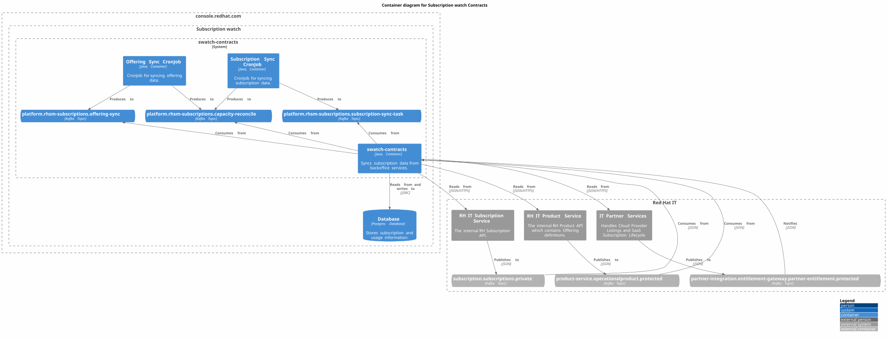

# swatch-contracts

swatch-contracts is a service deployed within the Subscription Watch ecosystem that manages
customer subscription and contract data. The service synchronizes subscription information from
Red Hat IT backoffice services, processes contract entitlements from cloud marketplace partners
(AWS, Azure), and provides contract coverage information to other SWATCH services for billing
calculations.

The service receives contract entitlement events from Partner Gateway via Kafka,
enriches them with data from Partner API and Subscription API, and stores normalized contract and
subscription data in the database. It also performs periodic synchronization of subscription data
from IT Subscription Service and offering definitions from IT Product Service to keep the local
data up to date.

An incoming partner entitlement event contains information about a customer's marketplace purchase,
including subscription details, contract dimensions (metrics and their contracted values), billing
identifiers, and validity dates. The service processes this data to create or update contract records
that other SWATCH services can query to determine what usage is covered by customer contracts.

An outgoing contract coverage response will contain:
  - The total contracted amount for a specific metric
  - Whether the contract is marked as gratis (free usage)
  - The contract validity period
  - Billing provider and account information

In short, swatch-contracts acts as the source of truth for subscription and contract data within
the SWATCH ecosystem, enabling accurate billing calculations by swatch-billable-usage and proper
capacity tracking across the system.

## Component/Flow Diagram


### Contract Kafka Message Consumer
The Contract Kafka Message Consumer is the main entry point for partner entitlement events. It consumes
messages from the Partner Gateway Kafka topic (partner-integration.entitlement-gateway.partner-entitlement.protected) when
customers purchase or modify subscriptions through cloud marketplace partners.

#### Partner Entitlement Processing
When a partner entitlement event is received:
1. The service parses the PartnerEntitlementContract message from Kafka.
2. It queries the Partner API to retrieve full entitlement details including contract dimensions,
   billing identifiers, and subscription numbers.
3. It queries the Subscription API to find the corresponding subscription ID that matches the
   entitlement data.
4. The service creates or updates contract records in the database with normalized data including:
   - Contract metadata (subscription number, SKU, start/end dates, organization ID)
   - Billing information (provider, provider ID, billing account ID)
   - Contract metrics (metric ID and contracted values for each dimension)
5. Associated subscription records are created or updated to link the contract to the subscription ID.

### Subscription Synchronization
The Subscription Sync Service performs periodic bulk synchronization of subscription data from the
IT Subscription Service. A scheduled cron job triggers the sync process, which:
- Produces subscription sync tasks to the Kafka topic for parallel processing.
- Queries the IT Subscription Service for all active subscriptions.
- Creates or updates subscription entities in the database.
- Links subscriptions to offering definitions (product configurations).
- Triggers capacity reconciliation for affected organizations.

This ensures that even if real-time Kafka events are missed, the system remains synchronized with the authoritative
subscription data in IT systems.

### Offering Synchronization
The Offering Sync Service synchronizes product offering definitions from the IT Product Service. A
scheduled cron job triggers the sync process, which:
- Produces offering sync tasks to the Kafka topic for parallel processing.
- Queries the IT Product Service for offering definitions including product tags, metrics, and
  variant configurations.
- Creates or updates offering entities in the database.
- Links offerings to their parent products and tracks supported metrics.
- Triggers capacity reconciliation when offerings change.

Offering definitions determine which products are tracked by SWATCH, what metrics are measured, and
how usage data should be interpreted.

#### SLA and usage defaults

The existing flag `swatch.ui.resolved-sla-usage-filtering` controls the rollout of
Premium SLA and Production usage for offerings whose upstream `SERVICE_TYPE` or
`USAGE` attribute is absent or blank. When enabled, successful offering syncs,
product events, and JSON imports persist these defaults for null values. Non-empty
values that SWATCH cannot map remain `EMPTY`. Product placeholders such as `n/a`
still allow a child or derived SKU to supply the value.

When the flag is disabled, absent or blank upstream values stay null in persisted
offerings. API reports and subscription exports continue to normalize null values
to `EMPTY`; with the flag enabled, they resolve nulls to Premium and Production.
Utilization keeps treating `EMPTY` as a wildcard. With the flag enabled, null
values in utilization match Premium and Production respectively.

Offerings are shared across organizations. Enable this flag consistently for the
frontend and backend using a global strategy: the backend evaluates it without
user or organization context, and persisted defaults affect every organization
using an offering. A targeted or percentage rollout cannot isolate this backfill
to selected organizations.

The existing `POST /api/swatch-contracts/internal/rpc/offerings/sync` operation also
backfills null SLA and usage columns for eligible SKUs before enqueueing their
upstream sync tasks. The scheduled offering-sync job calls this operation. The
backfill runs only while the flag is enabled and the service is writable. It
updates `last_modified` and is safe to repeat.

Legacy `EMPTY` values are ambiguous: they may represent an absent upstream
attribute or a non-empty value that SWATCH could not map. A successful upstream
refresh is required to classify them. Product events that omit an attribute stored
as `EMPTY` trigger that refresh before defaults are applied. If the product service
is unavailable, the ambiguous `EMPTY` value remains unclassified. The bulk
backfill changes only null columns on SKUs outside the denylist.

Disabling the flag stops applying defaults to incoming null values. Defaults
already persisted remain until a successful sync replaces them with the current
upstream values, which may be null when an attribute is absent or blank.

### Product Status Kafka Consumer
The service consumes product status events from the IT Product Service Kafka topic
(product-service.operationalproduct.protected) to receive real-time notifications about changes to
product and offering definitions. When a product status event is received, the service triggers an
offering sync for the affected product.

### Subscription Status Kafka Consumer
The service consumes subscription status events from the IT Subscription Service Kafka topic
(`subscription.subscriptions.private`; stage: `stage.subscription.subscriptions.private`) to receive
real-time notifications about subscription changes. Messages are `SubscriptionOutboxEvent` JSON payloads.
When a subscription status event is received, the service processes the subscription update and
triggers capacity reconciliation if needed.

### Capacity Reconciliation
The Capacity Reconciliation Service processes capacity reconciliation tasks to ensure that the
subscription capacity views (aggregated views of contract coverage by organization and product) are
up to date. When subscriptions or contracts change, reconciliation tasks are produced to the Kafka
topic for asynchronous processing. The service:
- Aggregates contract metrics by organization, product, metric, and time period.
- Calculates total contracted capacity from all active contracts.
- Updates subscription capacity views for consumption by other services (swatch-billable-usage).
- Handles contract termination and subscription expiration.

### Contract Coverage Queries
Other SWATCH services (particularly swatch-billable-usage) query swatch-contracts via REST API to
retrieve contract coverage information for billing calculations. The service provides endpoints to:
- Query contracts by organization, product, vendor, and billing account.
- Retrieve aggregated contract metrics for a specific time period.
- Determine if usage should be billed or is covered by contracts.
- Check if contract coverage is marked as gratis (no billing required).

### Data Export
The service supports exporting subscription and contract data in JSON and CSV formats for reporting
and integration purposes. Export requests are processed asynchronously via Kafka consumers to handle
large data sets efficiently.

## Mapping Partner API with Swatch Data

We enrich our data (contracts and subscriptions) from different third parties like Partner API and the Subscription API. 
In swatch-contracts, we trigger the enrichment when receiving events from the Partner Gateway, then 
we call again the Partner API to gather extra information <1> we need to move forward and 
finally, we call the Subscription API to find the subscription ID <2> that matches with the event <1> we received. 
Each of these sources are enumerated as follows:
- <1> the response from Partner API is of type [PartnerEntitlements](https://github.com/RedHatInsights/rhsm-subscriptions/blob/5bce20986bb3c1b2750502db63efc694461cce57/clients/rh-partner-gateway-client/rh-partner-gateway-api-spec.yaml#L41)
- <2> from the response from Subscription API, we simply extract the subscription ID.

## Testing Internal Contracts Endpoint

For testing purposes, we can use the POST endpoint `/api/swatch-contracts/internal/contracts` with payload:

```json
{
  "partner_entitlement": <1>
}
```

### Field Mapping Reference


| Table            | Column               | Source                                                                                                                                                                          |
|------------------|----------------------|---------------------------------------------------------------------------------------------------------------------------------------------------------------------------------| 
| contracts        | subscription_number  | <1>.rhEntitlements[*].subscriptionNumber                                                                                                                                        |
| contracts        | org_id               | <1>.rhAccountId                                                                                                                                                                 |
| contracts        | sku                  | <1>.rhEntitlements[*].sku                                                                                                                                                       |
| contracts        | start_date           | <1>.entitlementDates.startDate                                                                                                                                                  |
| contracts        | end_date             | <1>.entitlementDates.endDate                                                                                                                                                    |
| contracts        | vendor_product_code  | <1>.purchase.vendorProductCode                                                                                                                                                  |
| contracts        | billing_account_id   | if not null: <1>.partnerIdentities.customerAwsAccountId                                                                                                                         |
| ^                | ^                    | if not null: <1>.partnerIdentities.azureTenantId,<1>.partnerIdentities.azureSubscriptionId                                                                                      |
| ^                | ^                    | if not null: <1>.partnerIdentities.azureTenantId                                                                                                                                |
| contracts        | billing_provider_id  | if <1>.sourcePartner is "azure_marketplace", <br>then combination of <1>.purchase.azureResourceId,<1>.purchase.contracts[*].planId and <1>.purchase.vendorProductCode           |
| ^                | ^                    | if <1>.sourcePartner is "aws_marketplace", <br>then combination of <1>.purchase.vendorProductCode,<1>.partnerIdentities.awsCustomerId and <1>.partnerIdentities.sellerAccountId |
| contracts        | billing_provider     | <1>.sourcePartner                                                                                                                                                               |
| contract_metrics | metric_id            | <1>.purchase.contracts[*].dimensions[*].name                                                                                                                                    |
| contract_metrics | metric_value         | <1>.purchase.contracts[*].dimensions[*].value                                                                                                                                   |

### Complete Example

```bash
curl -v -X POST http://localhost:8000/api/swatch-contracts/internal/contracts \
-H 'Content-Type: application/json' \
--data-binary @- << EOF
{
  "partner_entitlement": {
    "rhAccountId": "123456",
    "sourcePartner": "aws_marketplace",
    "entitlementDates": {
      "startDate": "2023-05-24T18:46:05Z",
      "endDate": "2023-05-24T20:46:06.273014Z"
    },
    "rhEntitlements": [
      {
        "subscriptionNumber": "12585274",
        "sku": "MW01485"
      }
    ],
    "purchase": {
      "vendorProductCode": "AAAA",
      "contracts": [
        {
          "planId": "<only for azure>",
          "endDate": "2023-05-24T20:46:06.273014Z",
          "dimensions": [
            {
              "name": "Cores",
              "value": "8"
            }
          ]
        }
      ]
    },
    "partnerIdentities": {
      "awsCustomerId": "BBB",
      "sellerAccountId": "CCC",
      "customerAwsAccountId": "DDD"
    }
  }
}
EOF
```

**Expected Output:**

```json
{
  "status": {
    "status": "SUCCESS",
    "message": "New contract created"
  },
  "contract": {
    "uuid": "baa1dc70-9912-490b-94b6-76ffa67e6ca0",
    "subscription_number": "12585274",
    "sku": "MW01485",
    "start_date": "2023-05-24T18:46:05Z",
    "end_date": "2023-05-24T20:46:06.273014Z",
    "org_id": "123456",
    "billing_provider": "aws",
    "billing_provider_id": "AAAA;BBB;CCC",
    "billing_account_id": "DDD",
    "product_id": "OpenShift-metrics",
    "vendor_product_code": "ezcoaphi4bqc7lktoy2qfd6zi"
  }
}
```
